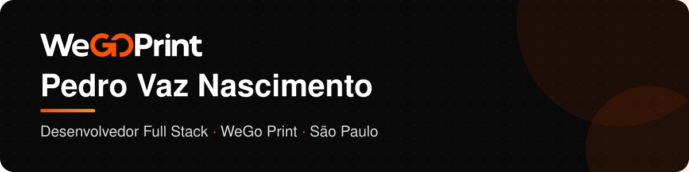

  

  

  
  
  

 

<h2 align="center">👋 Sobre mim</h2>

  Sou <b>desenvolvedor full stack</b> na <b><a href="https://www.wegoprint.com.br">WeGo Print</a></b>, empresa de comunicação visual de São Paulo 
  com mais de uma década de mercado: lonas, cenografia, feiras e eventos, 
  PDV, sinalização e envelopamento de frotas.

 

<h2 align="center">🛠️ Stack</h2>

<b>Frontend</b>

  
  
  
  
  
  

<b>Backend</b>

  
  
  
  

<b>Dados e ferramentas</b>

  
  
  
  
  

 

<h2 align="center">📊 GitHub</h2>

  
  

 

  

